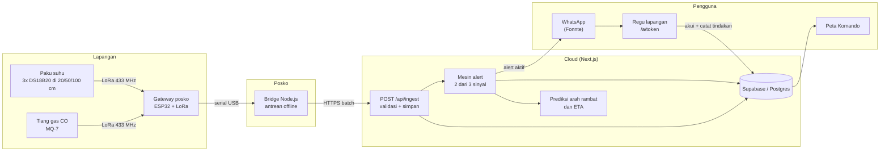

# PakuBara

**Pusat komando untuk memantau bara gambut setelah api permukaan padam.**

Paku sensor suhu dan tiang gas CO dipasang di lahan bekas terbakar. Datanya dikirim lewat radio LoRa ke posko, diperiksa oleh aturan "2 dari 3 sinyal", lalu regu pemadam menerima titik, kedalaman, dan arah rambat bara lewat WhatsApp. Semua tindakan tercatat sampai lahan dinyatakan aman.

Proyek Tim Tiga Trio untuk INCEPTION 2026 (Online Hackathon).

## Daftar isi

1. [Masalah dan solusi](#masalah-dan-solusi)
2. [Fitur](#fitur)
3. [Alur proses dari sensor sampai regu](#alur-proses-dari-sensor-sampai-regu)
4. [Logika deteksi](#logika-deteksi)
5. [Arsitektur teknis](#arsitektur-teknis)
6. [Struktur repositori](#struktur-repositori)
7. [Cara menjalankan](#cara-menjalankan)
8. [Mode demo dan simulator](#mode-demo-dan-simulator)
9. [Desain antarmuka](#desain-antarmuka)
10. [Status implementasi dan batasan](#status-implementasi-dan-batasan)
11. [Peta jalan](#peta-jalan)
12. [Dokumen pendukung](#dokumen-pendukung)
13. [Tim](#tim)
14. [AI Use and Third-Party Declaration](#ai-use-and-third-party-declaration)

## Masalah dan solusi

**Masalah.** Kebakaran gambut membara tanpa lidah api dan menjalar di bawah permukaan. Gambut kering menjadi isolator panas, sehingga bara bersuhu sekitar 500 sampai 700 °C terperangkap di bawah serasah yang terasa dingin. Bara di kedalaman sekitar 20 cm bisa bertahan berminggu-minggu dan muncul lagi ke permukaan tanpa tanda. Regu pemadam tidak punya alat untuk tahu kapan lahan benar-benar aman ditinggalkan, sehingga mereka kembali ke lokasi yang sama berulang kali. Angka dan sumbernya ada di Concept Proposal (bagian 1) dan ditampilkan di landing page.

**Solusi.** PakuBara memantau suhu tanah di tiga kedalaman (20, 50, dan 100 cm) dan gas CO di atas permukaan, lalu menjawab tiga pertanyaan koordinator:

| Pertanyaan | Jawaban dari PakuBara |
|---|---|
| Baranya di mana dan sedalam apa? | Peta Komando dengan marker per paku dan suhu tiga kedalaman |
| Ke mana baranya merambat? | Panah arah rambat dan perkiraan waktu muncul (ETA) |
| Kapan lahan aman? | Penghitung hari stabil per area (awal 3 hari) dan log tindakan sampai ditutup |

## Fitur

| Halaman | Rute | Fungsi |
|---|---|---|
| Landing | `/` | Penjelasan masalah, penampang tanah interaktif, angka bersumber, alur kerja |
| Peta Komando | `/app` | KPI wilayah, peta live dengan marker paku dan tiang gas, panah rambat, bilah waktu proyeksi, detail titik |
| Pusat Alert | `/app/alerts` | Daftar alert dengan tiga sinyal, akui alert, tandai selesai |
| Prioritas Siaga | `/app/risk` | Grid risiko 1 km², peringkat sel, ekspor CSV |
| Detail Area | `/app/areas/[areaId]` | Ringkasan area, rantai hari aman |
| Detail Titik | `/app/nodes/[nodeId]` | Grafik deret waktu suhu dan CO, status, arah rambat |
| Analitik | `/app/analytics` | Tren dan distribusi status |
| Perangkat dan Gateway | `/app/devices` | Inventaris paku, tiang gas, gateway, baterai, sinyal |
| Laporan Audit | `/app/reports` | Unduh laporan PDF per area dan CSV tindakan |
| Pengaturan | `/app/settings` | Ambang alert, penerima WhatsApp, uji WhatsApp |
| Simulator Juri | `/demo` | Empat skenario dan kontrol suhu tanpa perangkat keras |
| Status Publik | `/status/[areaSlug]` | Status ringkas untuk warga dan Masyarakat Peduli Api |
| Tautan Alert Regu | `/a/[token]` | Halaman satu titik untuk regu di lapangan, tanpa login, berlaku 24 jam |
| Login | `/login` | Masuk lewat magic link Supabase, dan akses cepat juri |

## Alur proses dari sensor sampai regu



Langkah rinci:

1. **Ukur.** Paku mengirim suhu tiga kedalaman dan tegangan baterai. Tiang gas mengirim CO. Interval normal 5 menit, naik ke 1 menit saat suhu naik (mode siaga). Paket biner 18 byte dengan CRC-16, sesuai PRD bagian 4.2.
2. **Teruskan.** Gateway di posko memvalidasi CRC lalu menulis satu baris JSON per paket ke port serial.
3. **Antre dan kirim.** Bridge ([bridge/index.mjs](bridge/index.mjs)) menambahkan cap waktu, menyimpan paket ke antrean di disk bila internet putus, lalu mengirim batch ke `POST /api/ingest` dengan kunci gateway.
4. **Validasi dan simpan.** Rute ingest memeriksa kunci gateway dan skema (Zod), membuang paket yang tidak valid, dan menyimpan bacaan.
5. **Evaluasi.** Mesin alert ([lib/alerts/engine.ts](lib/alerts/engine.ts)) menghitung tiga sinyal dan menentukan status titik.
6. **Prediksi.** Bila bara aktif, [lib/predict/spread.ts](lib/predict/spread.ts) memperkirakan arah rambat, kedalaman bara, ETA muncul di permukaan, dan saran volume air.
7. **Beri tahu.** Alert aktif membuat tautan bertanda tangan (JWT, 24 jam) dan mengirim pesan WhatsApp lewat Fonnte.
8. **Tindak.** Regu membuka tautan, menekan "Saya menuju lokasi", dan mencatat tindakan. Koordinator menandai selesai atau alarm palsu dari Pusat Alert.
9. **Nyatakan aman.** Area dinyatakan aman setelah semua titik normal selama jumlah hari yang disyaratkan (awal 3 hari).

## Logika deteksi

Alert hanya dikirim bila **minimal 2 dari 3 sinyal** terpenuhi. Aturan ini sengaja sederhana agar bisa dijelaskan ke regu. Nilai awal ada di `DEFAULT_THRESHOLDS` dan bisa diubah di halaman Pengaturan.

| Sinyal | Terpenuhi jika | Nilai awal |
|---|---|---|
| **S1 Tren suhu** | Suhu salah satu kedalaman mencapai ambang, atau laju kenaikan melewati ambang (regresi, minimal 6 titik data, R² minimal 0,6) | 60 °C atau 3 °C/jam |
| **S2 Paku tetangga** | Minimal satu paku lain dalam radius ikut naik | 50 m, kenaikan minimal 1,5 °C/jam |
| **S3 Gas CO** | Tiang gas terdekat membaca CO di atas ambang, atau di atas median 24 jam ditambah 3 simpangan baku | 50 ppm |

Sinyal yang tidak bisa dinilai (tidak ada tetangga atau tiang gas dalam radius) ditandai abu-abu, dan titik seperti itu hanya bisa naik sampai Waspada, tidak sampai Bara Aktif. Sensor DS18B20 dianggap jenuh pada 124 °C.

**Lima status titik** (selalu dipasangkan dengan bentuk atau ikon, bukan hanya warna):

| Status | Arti |
|---|---|
| Normal | Semua kedalaman di bawah ambang, tren datar |
| Pantau (watch) | Satu sinyal terpenuhi |
| Waspada (warning) | Satu sinyal kuat atau tren naik berkelanjutan |
| Bara Aktif (active) | 2 dari 3 sinyal terpenuhi, alert dikirim |
| Offline | Tidak ada paket lebih dari 3 kali interval kirim |

**Prediksi rambat.** Dari laju kenaikan suhu paku-paku di sekitar titik aktif, sistem menghitung arah (derajat dan mata angin), kecepatan (cm/jam), kedalaman bara (20, 50, atau 100 cm), ETA ke permukaan, tingkat keyakinan, dan saran volume air. Ini model berbasis fisika sederhana, bukan model pembelajaran mesin. Skrip kalibrasi dan model risiko ada di [analysis/](analysis).

## Arsitektur teknis

```
Browser (React 19, Next.js App Router)
   |  fetch / polling                      Regu: halaman /a/[token] (tanpa login)
   v
Next.js route handlers  (app/api/*)  ---------->  Fonnte (WhatsApp)
   |   |   |                                       NASA FIRMS, Open-Meteo
   |   |   +-- lib/alerts, lib/predict, lib/integrations
   |   +------ lib/mock-store.ts  (penyimpanan memori untuk mode demo)
   +---------- Prisma + pg  -->  Supabase Postgres (+ RLS, Realtime)
```

**Tumpukan teknologi**

| Lapisan | Teknologi |
|---|---|
| Antarmuka | Next.js 16 (App Router), React 19, TypeScript, Tailwind CSS 4, Radix UI, Lucide |
| Peta | MapLibre GL JS, deck.gl |
| Grafik | Apache ECharts |
| Data | Supabase (Postgres, Auth, Realtime), Prisma, `pg` |
| Validasi dan keamanan | Zod, jose (JWT) |
| Notifikasi | Fonnte (WhatsApp) |
| Data eksternal | NASA FIRMS (titik api), Open-Meteo (angin, cuaca, kualitas udara) |
| Perangkat keras | ESP32, DS18B20, MQ-7, LoRa SX1278 433 MHz |
| Analisis | Python (NumPy, pandas, scikit-learn, SciPy) |

**Model data** ([prisma/schema.prisma](prisma/schema.prisma)): `Organization`, `Profile` (peran admin, coordinator, responder, viewer), `Area`, `Gateway`, `Node`, `Reading`, `Prediction`, `Alert`, `Notification`, `Action`, `Threshold`, `RiskCell`, `Hotspot`, `Weather`, `DeviceCommand`. Migrasi SQL dan kebijakan Row Level Security ada di [supabase/migrations](supabase/migrations).

**Ringkasan API** (semua di `app/api`):

| Kelompok | Rute | Catatan |
|---|---|---|
| Ingest | `POST /api/ingest` | Butuh kunci gateway (`x-gateway-key` atau `Authorization: Bearer`) |
| Data | `/api/nodes`, `/api/nodes/[id]`, `/api/nodes/[id]/readings`, `/api/areas`, `/api/areas/[id]/summary`, `/api/gateways`, `/api/stats/overview` | Dibaca peta dan halaman |
| Alert | `/api/alerts`, `/api/alerts/[id]`, `.../acknowledge`, `.../resolve`, `/api/actions` | Alur akui, selesai, catat tindakan |
| Tautan regu | `/api/public/alerts/[token]` (dan `/acknowledge`, `/actions`) | Token JWT 24 jam, hanya satu titik |
| Lapisan peta | `/api/layers/hotspots`, `/heat`, `/wind`, `/risk` | Sumber lapisan peta |
| Laporan | `/api/reports/actions.csv`, `/api/reports/areas/[id]/pdf` | Unduhan |
| Tugas terjadwal | `POST /api/internal/{firms,weather,risk,rollup,offline-check,area-safety}` | Butuh `Authorization: Bearer $CRON_SECRET` |
| Demo | `/api/demo/{scenarios,heat,reset}`, `/api/alerts/test` | Simulator dan uji WhatsApp |
| Gateway | `/api/gateways/[id]/config`, `/api/gateways/commands/ack` | Konfigurasi dan perintah ke gateway |

**Keamanan.** Gateway diautentikasi dengan kunci rahasia. Tautan regu memakai JWT bertanda tangan yang berlaku 24 jam dan hanya membuka satu titik. Tugas terjadwal membutuhkan token bearer. Hak akses per peran dirancang lewat Row Level Security di database (lihat [Status implementasi](#status-implementasi-dan-batasan) untuk yang sudah berjalan).

## Struktur repositori

```
PakuBara/
├── app/                      Halaman dan API (Next.js App Router)
│   ├── page.tsx              Landing
│   ├── login/ demo/          Login dan Simulator Juri
│   ├── app/                  Peta Komando, alert, risiko, perangkat, laporan, pengaturan
│   ├── status/[areaSlug]/    Status publik
│   ├── a/[token]/            Tautan alert untuk regu
│   └── api/                  Route handler (ingest, alerts, nodes, layers, demo, internal, ...)
├── components/
│   ├── layout/               Navbar, sidebar, toggle tema, hook alert terbuka
│   ├── map/                  CommandMap (peta), TimelineReplayBar
│   ├── charts/               Grafik ECharts dan penampang tanah (SVG)
│   ├── simulator/            Simulator di dalam peta
│   └── ui/                   Logo, ImageSlot
├── lib/
│   ├── alerts/               Mesin 2-dari-3 sinyal, token JWT
│   ├── predict/              Regresi laju suhu, prediksi arah rambat
│   ├── integrations/         Fonnte, NASA FIRMS, Open-Meteo
│   ├── simulator/            Definisi skenario demo
│   ├── validators/           Skema Zod
│   ├── mock-store.ts         Data demo di memori
│   └── prisma.ts             Klien database
├── prisma/                   Skema dan migrasi Prisma
├── supabase/                 Migrasi SQL (skema, RLS, Realtime) dan seed
├── bridge/                   Jembatan serial LoRa ke HTTP (Node.js)
├── firmware/                 Sketch Arduino: gateway, node-probe, node-gas
├── analysis/                 Skrip kalibrasi dan model risiko (Python)
├── public/                   Gambar, worker MapLibre
├── docs/                     Prompt gambar dan dokumen pendukung
├── anti-slop/                Catatan audit antarmuka
├── DESIGN.md                 Arah desain dan token warna
└── proxy.ts                  Penyegar sesi Supabase
```

## Cara menjalankan

**Prasyarat:** Node.js 20 atau lebih baru, npm. Database Supabase opsional untuk mode demo.

```bash
npm install
npx prisma generate
```

**Variabel lingkungan.** Buat `.env.local` (tidak ikut git). Nama variabel dan fungsinya:

| Variabel | Fungsi |
|---|---|
| `NEXT_PUBLIC_SUPABASE_URL`, `NEXT_PUBLIC_SUPABASE_PUBLISHABLE_KEY` | Klien Supabase di browser |
| `SUPABASE_SERVICE_ROLE_KEY` | Akses server ke Supabase (jangan dibagikan) |
| `DATABASE_URL`, `DIRECT_URL` | Koneksi Postgres untuk Prisma (pooler dan langsung) |
| `GATEWAY_SECRET` | Kunci yang diminta rute ingest dari gateway |
| `ALERT_LINK_SECRET` | Kunci penandatangan token tautan regu |
| `CRON_SECRET` | Token bearer untuk rute `/api/internal/*` |
| `FONNTE_TOKEN`, `FONNTE_DEFAULT_TARGET` | Pengiriman WhatsApp dan nomor tujuan bawaan |
| `NASA_FIRMS_MAP_KEY` | Kunci API titik api satelit |
| `NEXT_PUBLIC_APP_URL` | URL publik aplikasi (untuk tautan di pesan) |

Tanpa `FONNTE_TOKEN`, WhatsApp tidak terkirim dan aplikasi menampilkan pesan gagal yang jelas. Jangan memasukkan nilai rahasia ke repositori.

**Menjalankan aplikasi:**

```bash
npm run dev          # http://localhost:3000
```

Jika `next dev` gagal di Windows dengan pesan binary native diblokir (Application Control), jalankan dengan Webpack:

```bash
npx next dev --webpack
npx next build --webpack
```

**Database (opsional):**

```bash
npm run db:migrate   # migrasi Prisma (pengembangan)
npm run db:deploy    # terapkan migrasi
```

Migrasi SQL Supabase (`supabase/migrations`) dan `supabase/seed.sql` dijalankan lewat editor SQL atau CLI Supabase.

**Bridge posko** (di komputer yang terhubung ke gateway LoRa). Bridge membaca satu baris JSON per paket dari `stdin`, jadi arahkan keluaran port serial gateway (115200 baud) ke sana:

```bash
cd bridge
npm install
# <keluaran serial gateway> | npm start
PAKUBARA_INGEST_URL=https://<alamat-app>/api/ingest PAKUBARA_GATEWAY_KEY=<kunci> npm start
```

Nilai `PAKUBARA_GATEWAY_KEY` harus sama dengan `GATEWAY_SECRET` di server. Paket yang gagal terkirim disimpan di `bridge_offline_queue.json` dan dikirim ulang.

**Firmware:** buka sketch di `firmware/node-probe`, `firmware/node-gas`, dan `firmware/gateway` dengan Arduino IDE, pilih papan ESP32, lalu unggah. Membutuhkan pustaka LoRa untuk SX1278.

**Analisis:**

```bash
pip install -r analysis/requirements.txt
python analysis/kalibrasi_uji_bak_gambut.py
```

## Mode demo dan simulator

Juri dapat menilai tanpa perangkat keras. Halaman **Simulator Juri** (`/demo`) menyediakan:

| Skenario | Yang terjadi |
|---|---|
| Perambatan bara ke timur laut | Paku PK-04 naik, tetangga PK-05 ikut naik, gas GS-01 terdeteksi: 3 dari 3 sinyal, status Bara Aktif |
| Alarm palsu, hanya CO naik | Hanya 1 sinyal terpenuhi: status Pantau, tidak ada WhatsApp darurat |
| Paku kehabisan baterai | Baterai turun dan titik berubah menjadi Offline |
| Pemulihan area | Suhu turun di bawah 35 °C dan hitungan hari stabil dimulai |

Ada juga kontrol suhu manual untuk satu titik dan tombol reset. **Perhatian:** skenario yang menghasilkan alert dan tombol "Kirim Alert Uji" mengirim **WhatsApp sungguhan** lewat Fonnte bila `FONNTE_TOKEN` dan nomor tujuan terisi.

## Desain antarmuka

Tampilan dasar terang dan bersih, dengan mode gelap lewat tombol di bilah atas. Token warna, aturan tema, dan arah desain ada di [DESIGN.md](DESIGN.md). Catatan audit antarmuka ada di [anti-slop/](anti-slop).

## Status implementasi dan batasan

Dokumen ini jujur tentang apa yang sudah jalan dan apa yang masih demo.

| Bagian | Status |
|---|---|
| Peta Komando, detail titik, grafik, Pusat Alert, laporan, simulator | Berjalan dengan data demo di memori (`lib/mock-store.ts`) |
| Mesin 2-dari-3 sinyal dan prediksi rambat | Berjalan dan dipakai oleh ingest dan simulator |
| WhatsApp lewat Fonnte | Berjalan bila token dan nomor tujuan diisi |
| Lapisan titik api (FIRMS) dan angin (Open-Meteo) | Rute dan integrasi ada; peta saat ini memakai data demo untuk angin |
| Penyimpanan Supabase/Postgres | Skema, migrasi, dan RLS tersedia; alur aplikasi utama masih memakai penyimpanan memori untuk demo |
| Login dan hak akses per peran | Login magic link ada, tetapi halaman `/app` belum dilindungi; "akses cepat juri" langsung masuk. Penegakan peran lewat RLS belum terhubung ke alur aplikasi |
| Grid Prioritas Siaga | Dibangkitkan dengan rumus demo, bukan model hasil pelatihan. Rute `/api/internal/risk` masih berupa stub |
| Prediksi ETA dan saran air di panel detail titik | Teks demo statis untuk PK-04 dan PK-K03 |
| Kunci rahasia bawaan di kode | Rute ingest dan token tautan punya nilai bawaan bila variabel lingkungan kosong. **Wajib diatur** di produksi |
| Perangkat keras | Firmware dan bridge tersedia; belum diuji di lahan, hanya di bak uji menurut proposal |
| Bridge | `bridge/index.mjs` yang dipakai (`npm start`). `bridge/serial-bridge.js` adalah varian lama berformat CommonJS dan tidak bisa jalan di paket bertipe module tanpa diganti namanya. Nilai bawaan kunci gateway di bridge dan di server berbeda, jadi keduanya harus diatur ke nilai yang sama |
| Pengujian otomatis | Belum ada rangkaian uji; verifikasi dilakukan manual dan lewat type-check, lint, dan build |

## Peta jalan

- Hubungkan alur utama ke Supabase dan tegakkan hak akses per peran.
- Ganti grid risiko demo dengan data dan model nyata, dengan sumber yang jelas.
- Lindungi halaman `/app` dan hapus nilai rahasia bawaan.
- Tambah pengujian otomatis untuk mesin alert dan rute ingest.
- Ganti model fisika rambat dengan model pembelajaran mesin bila data lapangan cukup.
- PWA offline untuk regu dan dukungan beberapa organisasi.

## Dokumen pendukung

- PRD Website PakuBara dan Concept Proposal PakuBara (arah produk, arsitektur, angka bersumber).
- [DESIGN.md](DESIGN.md): arah desain dan token warna.
- [docs/image-prompts.md](docs/image-prompts.md): prompt untuk ilustrasi.
- [anti-slop/](anti-slop): audit antarmuka dan laporan perbaikannya.

## Tim

Tim Tiga Trio, INCEPTION 2026. Kontributor repositori mengikuti riwayat commit.

## AI Use and Third-Party Declaration

### AI use

AI assistants were used as a helper during development, mainly for code suggestions and refactoring, the UI redesign, and drafting supporting documents (`DESIGN.md`, the antislop audit notes, and the image prompts in `docs/image-prompts.md`). The product idea, requirements (see the PRD and Concept Proposal), system design, hardware, and the final decisions come from the team, who remain responsible for everything in this repository.

The illustrations in `public/images/` (landing page steps and the empty state of the command map) were generated with an AI image tool from the prompts in `docs/image-prompts.md`, then cropped and converted to WebP for the layout.

### Third-party software

Used under their own licenses; see each package for the terms.

- **Web app:** Next.js, React, Tailwind CSS, Radix UI, Lucide icons, class-variance-authority, clsx, tailwind-merge, TanStack Query, Framer Motion, date-fns, Zod, jose, jsPDF and jspdf-autotable.
- **Maps and charts:** MapLibre GL JS, deck.gl, Apache ECharts and echarts-for-react.
- **Data layer:** Supabase (`@supabase/supabase-js`, `@supabase/ssr`), Prisma and `pg`.
- **Fonts:** Inter and JetBrains Mono, loaded through `next/font` (SIL Open Font License).
- **Vendored file:** `public/maplibre/` contains the MapLibre GL JS worker copied unmodified from the `maplibre-gl` package (BSD-3-Clause), so the map works in webpack mode.
- **Analysis scripts (`analysis/`):** NumPy, pandas, scikit-learn and SciPy.
- **Firmware (`firmware/`):** Arduino core and the LoRa and SPI libraries.
- **Bridge (`bridge/`):** dotenv.

### Third-party services and data

- **Supabase:** database, auth and realtime.
- **Vercel:** deployment of the web app.
- **Fonnte:** WhatsApp alert delivery.
- **NASA FIRMS:** satellite hotspot layer.
- **Open-Meteo:** wind, weather and air quality.
- **Map tiles:** OpenStreetMap contributors and Esri (ArcGIS Online basemaps), shown with their attribution on the map.
- **Published figures on the landing page** (burnt area, losses, smouldering temperature and spread rate) come from the sources cited in the PakuBara Concept Proposal and are credited next to each number on the page.
